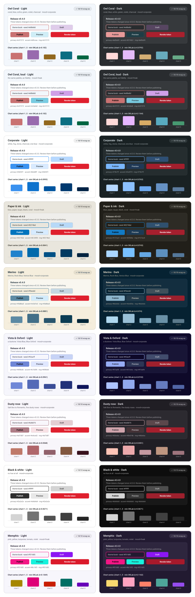
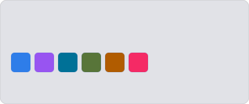
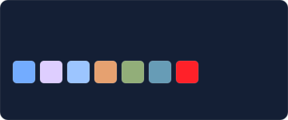
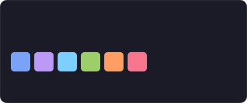
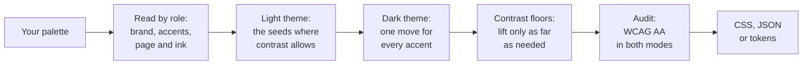
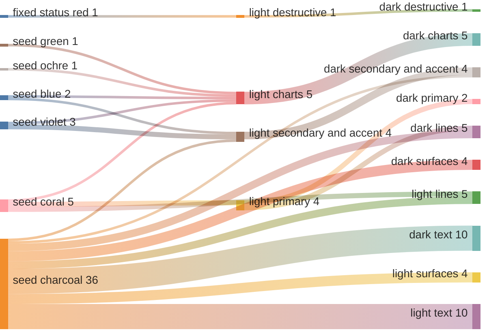

# theme-book

Give theme-book a palette, and it builds a light theme and a dark theme that read as one theme, pass WCAG AA in both modes, and trace every color back to the rule that chose it. It runs locally as a CLI and as an agent skill, on [David Aerne's (`@meodai`)](https://github.com/meodai) [design-book](https://github.com/meodai/design-book).



_Figure 1. Nine palettes, each as a light and dark pair built by theme-book. Generated by `bun run specimen`; a test fails if any two elements overlap._

| Contents |
| --- |
| [What it does](#what-it-does) · [Does it work?](#does-it-work) · [Try it](#try-it) · [How it works](#how-it-works) · [FAQ](#faq) · [Documentation](#documentation) · [Credits](#credits) · [License](#license) |

_Table 1. Contents._

## What it does

theme-book turns seed colors into complete design tokens and checks the tokens it did not write. It has four commands.

| Command | What you give it | What you get |
| --- | --- | --- |
| `theme` | One or more seed colors, a preset (`shadcn`, `semantic`, `slide-deck`) and a mood | Light and dark tokens as CSS, JSON with a replayable recipe, W3C Design Tokens, or an SVG of the rules, with a contrast audit |
| `audit` | An existing CSS or JSON token file | Every foreground and background pair checked at full precision against WCAG AA, AAA or APCA, with proposed fixes |
| `suggest` | A seed and a surface | Companion colors that read on that surface |
| `eval` | Your own design-book script | The script run with design-book, poline, rampensau and culori already installed |

_Table 2. The four commands. `theme` makes themes; the other three check, extend and explore them._

Every color theme-book writes is a rule, not a hand-picked value, so the same seeds always give the same theme, and the audit says which rule each failure came from.

## Does it work?

The hardest test for a theme generator is to give it one side of a theme a designer made by hand, and compare the side it generates with the designer's. Seven famous themes publish both sides: Solarized, Gruvbox, Tokyo Night, One, Catppuccin, Rosé Pine and GitHub. Figure 2 shows Tokyo Night: theme-book is given only the light side.

| Tokyo Night Day: the input | theme-book's dark, from the light side only | Tokyo Night: the designers' dark |
| --- | --- | --- |
|  |  |  |

_Figure 2. Tokyo Night Day goes in, theme-book's dark comes out, beside the designers' own Tokyo Night. The generated dark is the full theme: the primary, five chart colors ordered from light to dark, and the fixed error red. Charts take the palette's first five colors, so Tokyo's sixth, the pink, has no chart slot; Figure 3 and Table 3 cover all six._


_Figure 3. Each accent's move from light to dark, in OKLCH: lightness from bottom to top, hue from left to right. An × is the light theme's color, a □ the designers' dark color, an ○ theme-book's; the solid arrow is the designers' move and the dashed arrow is theme-book's. The gap between an ○ and its □ shows the miss in lightness and hue; the miss in Table 3 also counts chroma, which this chart does not plot, so the violet's overlapping marks still miss by 0.021._

Table 3 states each miss as a number: the distance in OKLab, the perceptual color space theme-book works in, where under 0.02 is indistinguishable.

| Accent | Tokyo Night Day (×) | Tokyo Night (□) | theme-book (○) | Miss (OKLab) |
| --- | --- | --- | --- | --- |
| primary | `#2e7de9` | `#7aa2f7` | `#75adff` | 0.028 |
| accent 1 | `#9854f1` | `#bb9af7` | `#bb94ff` | 0.021 |
| accent 2 | `#007197` | `#7dcfff` | `#64acce` | 0.111 |
| accent 3 | `#587539` | `#9ece6a` | `#92ad79` | 0.102 |
| accent 4 | `#b15c00` | `#ff9e64` | `#e0935b` | 0.062 |
| accent 5 | `#f52a65` | `#f7768e` | `#ff8598` | 0.036 |
| **mean** | | | | **0.060** |

_Table 3. The table from the observed output of `bun scripts/benchmark/score.ts --accents Tokyo`, which prints the method summary first. The primary and the violet land almost on the designers' colors; the teal and the green, which the designers lifted furthest, are where theme-book falls short._

Table 4 runs the same test on all seven themes, against two common alternatives: a Material-style tone table, and flipping each color's lightness.

| Theme | theme-book | Material-style tones | Flipping OKLCH lightness |
| --- | --- | --- | --- |
| Solarized | **0.139** | 0.226 | 0.226 |
| Gruvbox | **0.063** | 0.099 | 0.282 |
| Tokyo | **0.060** | 0.077 | 0.343 |
| One | **0.056** | 0.113 | 0.345 |
| Catppuccin | 0.095 | **0.081** | 0.433 |
| Rosé Pine | **0.078** | 0.099 | 0.383 |
| GitHub | **0.069** | 0.173 | 0.224 |

_Table 4. The table from the observed output of `bun scripts/benchmark/score.ts --per-theme`: mean OKLab distance from the designers' dark accents, lower is better, the best in bold. The Material-style tones are CIELAB lightness 40 and 80, an approximation: Material's own tones use HCT._

theme-book comes closest on six of the seven. Catppuccin is the loss: its dark accents are pastels, softer than the fitted move makes them. Solarized is the widest miss in absolute terms, because Solarized keeps its accents the same in both modes, which is what `--mood freak` does and `--mood corporate` does not. The [derived moods page](docs/topics/derived-moods/README.md) has the fit, a leave-one-out test, and the [full scoreboard](docs/topics/derived-moods/scoreboard.svg) of every theme in both directions.

## Try it

theme-book needs [Bun](https://bun.sh/) and installs from a checkout; there is no npm package.

```bash
git clone https://github.com/flyingrobots/theme-book.git
cd theme-book
./install.sh
```

_Listing 1. Installing. The command lands in `~/.local/bin/theme-book`, its runtime in `~/.theme-book/`._

Listing 2 builds a shadcn theme from one blue, with the contrast audit on.

```bash
theme-book theme --seed "#2563eb" --preset shadcn --mood corporate --audit --hex
```

_Listing 2. A first theme from one seed._

```text
/* theme-book v0.5.0 · design-book v0.26.0+main.2d80b33 · audit=pass (wcag-aa) */
:root {
  --background: #f4f7fc;
  --foreground: #262e3d;
  --primary: #2563eb;
  --primary-foreground: #ffffff;
  --secondary: #dce8ff;
  ...
}
.dark {
  --background: #141f35;
  --foreground: #d1d4da;
  ...
}
Contrast Audit [PASS] (wcag-aa): 36 passed, 0 failed, 0 unverified, 6 advisory
```

_Listing 3. Output of Listing 2 with theme-book v0.5.0, abridged to a few tokens per mode. The CSS goes to standard output and the audit summary to standard error; the CSS's first line, omitted here, is the command that reproduces it._

The blue stays exactly `#2563eb` as the light primary, the dark page takes the blue's hue at a deep navy, and all 36 required pairs pass. The [CLI reference](docs/topics/cli/README.md) covers every option, the other presets and moods, auditing your own files, and extensions.

## How it works

theme-book reads the palette by role, builds the light theme from the seeds, moves every accent to dark together, and lifts each color only as far as its contrast floor needs. Figure 4 shows the pipeline for the `corporate` and `freak` moods.



_Figure 4. How a palette becomes a light and dark theme. Each step is a rule in the book, so each color records where it came from._

The move is the part fitted to the famous themes. Every accent keeps its hue, and its dark lightness is `(1 − b)(L + s) + b · 0.76`, with chroma scaled by `k`. One setting, `s 0.12`, `b 0.6`, `k 0.85`, lands closest on average. A move like this keeps the accents' relationships intact between modes, which is why the two themes read as one. Flipping each color's lightness scrambles them.

<details>
<summary>Where Owl Coral's colors come from, traced through the book</summary>



_Figure 5. Owl Coral's palette as a corporate theme, from `bun scripts/benchmark/sankey.ts`. Each seed flows into the light roles that record it as their origin; a dark role flows from the light role it derives from (the accents, destructive and the charts; the rings, from light primary), or otherwise from its own seed (the surfaces, text and borders)._

</details>

The full derivation, every rule and the limits are on the [derived moods page](docs/topics/derived-moods/README.md).

## FAQ

These are the questions people ask first. Each answer was checked against theme-book v0.5.0.

<details>
<summary><strong>Can I provide my own rules?</strong></summary>

Yes. Write a book extension: a small TypeScript file that names a preset and its rules version, and overrides some of its rules with design-book expressions. Pass it with `--book`. theme-book refuses an extension written for a different rules version, loads only the exact bytes it hashed, and audits the result like any preset. The [CLI reference](docs/topics/cli/README.md#extend-a-preset-with-your-own-rules) has an example and the full contract.

Two limits apply to the `corporate` and `freak` moods. An extension sees only their `seeds` and `palette` scopes, so one written against a classic mood's pools exits `2` under them. And the fitted move (`s`, `b`, `k`) is not yet an option you can set.

</details>

<details>
<summary><strong>Does it work with shadcn/ui and Tailwind?</strong></summary>

Yes. `--preset shadcn` emits exactly the token set `shadcn init` writes, as `:root` and `.dark` CSS variables in `oklch()`, or hex with `--hex`. A test compares the token set with shadcn's own. The audit marks colors outside the sRGB gamut, such as stock Tailwind v4's wide-gamut stops, as unverified rather than passing them.

</details>

<details>
<summary><strong>Can it check a theme I already have?</strong></summary>

Yes: `theme-book audit path/to/tokens.css`. It reads CSS (including `@layer`, `@media (prefers-color-scheme: dark)`, `.dark` and `var()` aliases), theme-book JSON and W3C Design Tokens JSON, measures every pair at full precision, and exits `1` on a failure, `3` when a required pair could not be measured. `--fix` proposes repairs. See [contrast auditing](docs/topics/contrast-auditing/README.md).

</details>

<details>
<summary><strong>WCAG AA, AAA or APCA?</strong></summary>

All three, with `--standard`. The `high-contrast` mood builds for AAA; `corporate` and `freak` build for AA. Asking those two for AAA or APCA audits the theme against that standard but does not change its colors, so expect failures. Read APCA alongside WCAG either way: WCAG 2 treats light text on dark and dark text on light the same, and APCA does not.

</details>

<details>
<summary><strong>Which moods are there?</strong></summary>

`neutral`, `muted`, `vivid`, `editorial` and `high-contrast` work with every preset. `corporate` and `freak` build light and dark from a whole palette, for shadcn only: `corporate` is quiet (soft tints, accents lifted in dark), `freak` puts the palette's own colors on show. Give those two your whole palette, brand color first.

</details>

<details>
<summary><strong>Is it deterministic?</strong></summary>

Yes. The same seeds and options give the same theme. Every CSS file starts with the command that made it, and `--format json` records the full recipe (tool version, design-book version, seeds, preset, mood, generator, standard and any extension's hash).

</details>

<details>
<summary><strong>Do I need npm?</strong></summary>

No. theme-book runs on Bun from `~/.theme-book/`, installed by `./install.sh` from a checkout. design-book is vendored in `vendor/` until a release includes the commits theme-book needs ([meodai/design-book#5](https://github.com/meodai/design-book/issues/5)).

</details>

<details>
<summary><strong>Can I use the output in a closed-source project?</strong></summary>

The output is static CSS or JSON, and theme-book stays on your machine: design-book, which is AGPL-3.0-only, never becomes a dependency of your project. If you want to embed design-book itself in proprietary software, see [License](#license).

</details>

<details>
<summary><strong>Is there an agent skill?</strong></summary>

Yes. `skills/theme-book/` teaches a coding agent to generate themes with theme-book instead of picking colors by hand, and `install.sh` syncs it into an [agent-hub](https://github.com/flyingrobots/agent-hub) when one is installed. It pairs with meodai's [color-expert](https://github.com/meodai/skill.color-expert) skill.

</details>

When an answer here and the reference disagree, the reference and `theme-book --help` are right, and this FAQ is the bug.

## Documentation

The README is the tour; the pages in Table 5 are where to look things up.

| Page | What it covers |
| --- | --- |
| [The theme-book CLI](docs/topics/cli/README.md) | Install, every command and option, extensions, design decisions, the audit contract and exit codes |
| [Derived moods](docs/topics/derived-moods/README.md) | How `corporate` and `freak` work, how their rules were fitted to famous themes, and their limits |
| [Contrast auditing](docs/topics/contrast-auditing/README.md) | What `audit` checks, which standard to ask for, and how to read the result |
| [Documentation spine](docs/README.md) | Every durable page |
| [`AGENTS.md`](AGENTS.md) | Working agreement for contributors: the local gate (`bun test`), the install trap |
| [`CHANGELOG.md`](CHANGELOG.md) and [`RELEASE.md`](RELEASE.md) | What changed in each release, and how a release is cut |

_Table 5. Where the rest of the documentation lives._

To work on theme-book itself: `bun install --frozen-lockfile`, then `bun test` and `bun run typecheck`; `bun run specimen` redraws Figure 1, and `./install.sh` puts a change on your command line.

## Credits

theme-book exists because of David Aerne ([`@meodai`](https://github.com/meodai), [Elastiq GmbH](https://elastiq.ch/)), whose color engineering makes this workflow possible.

| Project | What it gives theme-book |
| --- | --- |
| [design-book](https://github.com/meodai/design-book) | The reactive constraint engine that records how each token is chosen, instead of freezing hex values |
| [poline](https://github.com/meodai/poline) | Anchor-based palette generation |
| [rampensau](https://github.com/meodai/rampensau) | Easing-driven color ramps |
| [color-expert](https://github.com/meodai/skill.color-expert) | A color knowledge base of more than 180 documents for AI agents |
| [culori](https://culorijs.org/) | Accurate OKLCH and OKLab conversions and gamut mapping |

_Table 6. The work theme-book builds on._

Sincere thanks to all of them.

## License

theme-book is licensed under [AGPL-3.0-only](LICENSE), in keeping with [design-book](https://github.com/meodai/design-book).

To embed design-book itself in proprietary or closed-source software, obtain a commercial license from [Elastiq GmbH](mailto:david@elastiq.ch). Running theme-book locally as an authoring tool that writes static CSS or JSON keeps the projects that use that output free of AGPL runtime dependencies.
