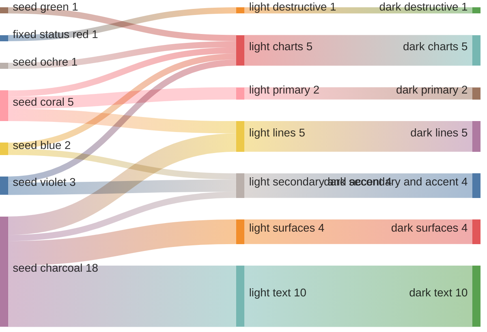

# Derived moods

`--mood corporate` and `--mood freak` build a light theme and a dark theme from one palette, so that the
two read as one theme. The rules were fitted to seven famous light/dark pairs, and a benchmark in this
repository scores them against those themes on every test run.

> [!NOTE]
> Agent-written on 2026-11-27 and not yet reviewed by a human.

## Use it

Give the palette as seeds, the first one being the primary. Both moods are for the `shadcn` preset only
(another preset exits `2`), and audit with WCAG AA by default.

```bash
theme-book theme --seed "#e88e8d" --seed "#79cce2" --seed "#d1a45f" --seed "#60bd90" \
  --seed "#cfa0e8" --seed "#292c2f" --preset shadcn --mood corporate --audit --hex
```

_Listing 1. Owl Coral's palette (coral, blue, ochre, green, violet, charcoal) as a corporate theme._

The first lines of standard output, and the audit's summary on standard error (abridged):

```text
/* theme-book v0.4.0 · design-book v0.26.0+main.2d80b33 · audit=pass (wcag-aa) */
:root {
  --background: #f3f7fc;
  --foreground: #292e34;
  --card: #fcfeff;
  --primary: #c97272;
  --primary-foreground: #000000;
  --secondary: #cfeef7;
  --accent: #dfccea;
  --destructive: #df202e;
  --chart-1: #c97272;
  ...
Contrast Audit [PASS] (wcag-aa): 26 passed, 0 failed, 0 unverified, 16 advisory
```

_Listing 2. Observed output of Listing 1, abridged to the main roles. The ochre and green seeds appear only in
the charts: they are caution and success hues, which never fill a button._

The two moods differ in how they treat the palette's colors:

| Mood | Accents in dark | Secondary and accent | Character |
| --- | --- | --- | --- |
| `corporate` | lifted together by the fitted average move | soft tints of the palette | quiet, one accent doing the work |
| `freak` | unchanged (Solarized's move) | the palette's own colors, flat, the same in both modes | loud, every color on show |

_Table 1. The two derived moods. Both share the base ramp, the fixed status red and the chart rules._

## How a palette becomes a theme

theme-book reads the palette by role, then builds every color as a rule on where it came from: a light
color is a rule on its seed, and a dark accent is a rule on its light version. The diagram below is traced
from the book theme-book built for Listing 1 (`bun scripts/benchmark/sankey.ts`), not drawn by hand.



_Figure 1. Where Owl Coral's colors come from. The charcoal seed is the base ramp (surfaces, text, lines);
coral is the primary; each chart is one seed; destructive is the fixed status red, from no seed._

The rules, in OKLCH:

| Rule | What it does | Evidence |
| --- | --- | --- |
| **The palette is read by role** | a near-grey seed is base material: the palest tints the light page, the darkest sets the ink; a colored seed is an accent | |
| **The base is one ramp** | the dark page takes the light theme's ink hue, at L about 0.24 (never black); each mode's text comes from the other end | the dark page's hue sits within 2-16° of the light ink's in six of the seven famous themes |
| **Accents move together** | dark L = (1 − b)(L + s) + b · 0.76, dark C = k · C, hue kept: `corporate` uses s 0.12, b 0.6, k 0.85; `freak` uses 0, 0, 1 | Table 3 |
| **Contrast is a floor in each mode** | after the move, a dark accent is lifted further until it clears 3:1 (4.5:1 for text it carries); never pushed the other way | |
| **Red is fixed** | destructive is one red, not the palette's; it holds white text (shadcn draws white on it), stands apart from a red primary, and in dark is set so that shadcn's 60% over the page lands on the same red | |
| **Status hues stay off actions** | secondary and accent never take a red, yellow or green palette color; the first seed is always primary, a red brand included | |
| **Charts run light to dark** | three or more accents are the charts; fewer, steps of the primary's hue; a palette with no hue gets stock shadcn's greys, the same in both modes | |

_Table 2. The rules of the derived moods, as built in [`src/derived.ts`](../../../src/derived.ts)._

## How the rules were derived

Seven famous themes publish both a light and a dark side: Solarized, Gruvbox, Tokyo Night, One, Catppuccin,
Rosé Pine and GitHub. Their palettes, checked against each project's own source, are in
[`scripts/benchmark/famous-themes.ts`](../../../scripts/benchmark/famous-themes.ts) with the source of each.
Fitting dark lightness against light lightness for each theme's accents gives two laws and a character knob:

| Theme | Fit (dark L against light L) | Mean lift | Chroma × | Reading |
| --- | --- | --- | --- | --- |
| Solarized | slope 1.00, offset 0.00, R² 1.00 | 0 | 1.00 | accents shared |
| Gruvbox | slope 0.97, offset +0.23, R² 1.00 | +0.22 | 1.25 | one lift for every accent |
| Catppuccin | slope 0.97, offset +0.24, R² 0.90 | +0.22 | 0.60 | one lift, pastel |
| Tokyo | slope −0.81, R² 0.87 | +0.19 | 0.99 | into one band |
| GitHub | slope −0.17 | +0.12 | 1.02 | into one band |
| Rosé Pine | slope 1.22 | +0.12 | 1.03 | |
| One | slope 0.60, R² 0.29 | +0.13 | 0.78 | |

_Table 3. Light-to-dark accent moves of seven famous themes, measured in OKLCH. Hue stays within a few degrees
except where a theme filters it deliberately (Gruvbox pulls every hue about 45% toward amber)._

Scored against the official accents (mean OKLab distance, lower is better; under 0.02 is indistinguishable):

| Method | Light → dark | Dark → light |
| --- | --- | --- |
| theme-book `corporate` (s 0.12, b 0.6, k 0.85) | **0.080** | **0.066** |
| Material's tone table (40 / 80) | 0.124 | 0.114 |
| HSL lightness inversion | 0.151 | 0.175 |
| Sharing the accents unchanged | 0.152 | 0.152 |
| OKLCH lightness inversion | 0.319 | 0.324 |

_Table 4. Observed output of `bun scripts/benchmark/score.ts`. Flipping lightness suits the page and the
ink, which do swap ends, and is the worst choice for accents, which designers lift a little._

Fitted on six themes and tested on the seventh, in turn, the formula scores 0.081 (both directions; the last
line of the same command), so it is not memorising the themes it was fitted to. The test suite fails if a change makes either column worse than 0.085 and 0.07,
or worse than Material's.


_Figure 2. The scoreboard (`bun scripts/benchmark/scoreboard.ts`). In the fourth chart, solid lines are the
designers' moves and dashed lines theme-book's, from the same source; the interactive
[scoreboard.html](scoreboard.html) toggles between that view, theme-book against the answer, and the
designers' moves alone._

## Limits

- **Two levers are measured but not built.** A *signature* (one deliberate rule break, like Solarized's teal
  page, honored while everything else bends around it) and *gravity* (every hue pulled toward one anchor, as
  Gruvbox pulls toward amber) explain most of the remaining distance in Table 4.
- **shadcn's dark destructive is drawn at 60% over the page.** The dark token is set as bright as sRGB allows,
  so the red reads as red; it is still deeper than light's, which only a component change could fix.
- **Chart bars are advisory in the audit** for these moods, as stock shadcn's would be: one shared lightness
  spread cannot clear 3:1 on both pages for every bar.
