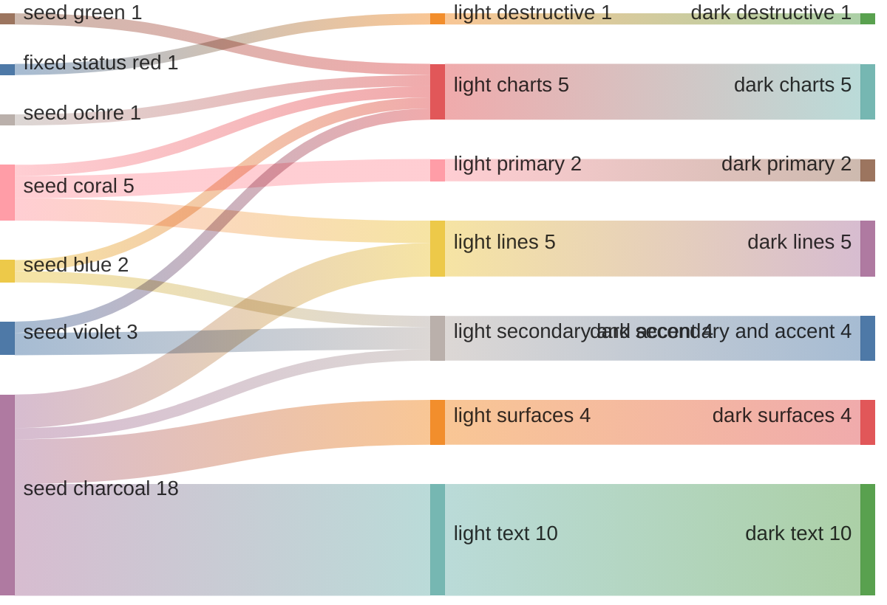

# Derived moods

`--mood corporate` and `--mood freak` build a light theme and a dark theme from one palette, so that the
two read as one theme. The rules were fitted to seven famous light/dark pairs, and a benchmark in this
repository scores them against those themes on every test run.

> [!NOTE]
> Agent-written on 2026-11-27 and not yet reviewed by a human.

## Use it

Give the palette as seeds, the brand color first: the first colored seed (OKLCH chroma 0.04 or more) is the
primary, whatever its lightness, and grey seeds are page and ink material wherever they stand. Both moods are
for the `shadcn` preset only (another preset exits `2`), and are built for WCAG AA.

```bash
theme-book theme --seed "#e88e8d" --seed "#79cce2" --seed "#d1a45f" --seed "#60bd90" \
  --seed "#cfa0e8" --seed "#292c2f" --preset shadcn --mood corporate --audit --hex
```

_Listing 1. Owl Coral's palette (coral, blue, ochre, green, violet, charcoal) as a corporate theme._

The first lines of standard output, and the audit's summary on standard error (abridged):

```text
/* theme-book v0.4.0 · design-book v0.26.0+main.2d80b33 · audit=pass (wcag-aa) */
:root {
  --background: #f3f7fc;
  --foreground: #292e34;
  --card: #fcfeff;
  --primary: #c97272;
  --primary-foreground: #000000;
  --secondary: #cfeef7;
  --accent: #dfccea;
  --destructive: #df202e;
  --chart-1: #c97272;
  ...
Contrast Audit [PASS] (wcag-aa): 36 passed, 0 failed, 0 unverified, 6 advisory
```

_Listing 2. Observed output of Listing 1, abridged to the main roles. The ochre and green seeds appear only in
the charts: they are caution and success hues, which never fill a button. `theme-book audit` of the saved file
gives the same verdict._

What the moods do not read:

- **`--generator` has no effect.** The palette is the seeds; no ramp is generated from them.
- **`--standard wcag-aaa` and `--standard apca` audit, but do not change the colors.** The rules solve for
  WCAG AA, so expect failures: Listing 1's palette fails 10 pairs under `wcag-aaa` and 7 under `apca`.
- **`suggest --mood corporate|freak` uses only those moods' chroma ranges**, not these rules, which apply to
  `theme`.
- **An extension (`--book`) sees only the `seeds` and `palette` helper scopes**, and `dark` does not extend
  `light`. An extension that refers to `neutrals` or another pool scope exits `2` under these moods.

The two moods differ in how they treat the palette's colors:

| Mood | Accents in dark | Secondary and accent | Character |
| --- | --- | --- | --- |
| `corporate` | lifted together by the fitted average move | soft tints of the palette | quiet, one accent doing the work |
| `freak` | unchanged (Solarized's move), unless one must be lifted to clear the dark page | the palette's own colors, flat and the same in both modes; a role left with no non-status palette color that can carry text becomes a tint | loud, every color on show |

_Table 1. The two derived moods. Both share the base ramp, the fixed status red and the chart rules. In both, the
primary is moved to the nearest lightness that holds its text and clears the page, so it can differ from its seed
(Listing 2: coral `#e88e8d` becomes `#c97272`)._

## How a palette becomes a theme

theme-book reads the palette by role and computes each color. Most colors in the book record an origin: a light
color its seed (text on a fill, and the base ramp, name the base seed), a dark accent its light version;
destructive names none. The values themselves are computed in TypeScript and stored fixed, so a record is an
origin, not a live dependency. The diagram below draws those
records from the book theme-book built for Listing 1 (`bun scripts/benchmark/sankey.ts`), not by hand.



_Figure 1. Where Owl Coral's colors come from. The charcoal seed is the base ramp (surfaces, text, lines);
coral is the primary; each chart is one seed; destructive is the fixed status red, from no seed._

The rules, in OKLCH:

| Rule | What it does | Evidence |
| --- | --- | --- |
| **The palette is read by role** | the first colored seed is primary, whatever its lightness; a near-grey seed, or a later colored seed that is very dark or very pale (OKLCH L ≤ 0.25 or ≥ 0.93), is base material: the palest tints the light page, the darkest sets the ink; any other colored seed is an accent | |
| **The base is one ramp** | the dark page takes the light theme's ink hue, at L about 0.24 (never black); each mode's text comes from the other end | the dark page's hue sits within 1.4–16.4° of the light ink's in six of the seven famous themes (Table 3) |
| **Accents move together** | dark L = (1 − b)(L + s) + b · 0.76, dark C = k · C, hue kept: `corporate` uses s 0.12, b 0.6, k 0.85; `freak` uses 0, 0, 1 | Table 3 |
| **Contrast is a floor in each mode** | after the move, a dark accent is lifted further until it clears 3:1 (4.5:1 for text it carries); never pushed the other way | |
| **Red is fixed** | destructive is one red, not the palette's; it holds white text (shadcn draws white on it), stands apart from a red primary, and in dark is set so that shadcn's 60% over the page lands as near light's red as sRGB allows (see Limits) | |
| **Status hues stay off actions** | secondary and accent never take a red, yellow or green palette color; the primary may, so a red brand stays red | |
| **Charts run light to dark** | three or more accents are the charts; fewer, steps of the primary's hue. Every bar clears 3:1 on the pages of its mode, and bars floored to one lightness are spaced apart. A palette with no hue gets stock shadcn's greys, the same in both modes, audited as advisory | |

_Table 2. The rules of the derived moods, as built in [`src/derived.ts`](../../../src/derived.ts)._

## How the rules were derived

Seven famous themes publish both a light and a dark side: Solarized, Gruvbox, Tokyo Night, One, Catppuccin,
Rosé Pine and GitHub. Their palettes, checked against each project's own source, are in
[`scripts/benchmark/famous-themes.ts`](../../../scripts/benchmark/famous-themes.ts) with the source of each.
For each theme, the script below pairs the primary and five accents by position and fits dark lightness
against light lightness (least squares). Chroma × is mean dark chroma over mean light chroma; hue drift is the
mean hue change of an accent; the last column is the base-ramp rule, the dark page's hue against the light ink's.

| Theme | Slope | Offset | R² | Mean lift | Chroma × | Hue drift | Dark page vs light ink hue |
| --- | --- | --- | --- | --- | --- | --- | --- |
| Solarized | 1.00 | +0.00 | 1.00 | +0.00 | 1.00 | 0° | 2.1° |
| Gruvbox | 0.97 | +0.23 | 1.00 | +0.22 | 1.08 | 18° | 48.5° |
| Tokyo | −0.81 | +1.23 | 0.87 | +0.19 | 0.83 | 3° | 16.4° |
| One | 0.57 | +0.39 | 0.24 | +0.13 | 0.73 | 17° | 10.2° |
| Catppuccin | 0.97 | +0.24 | 0.90 | +0.22 | 0.55 | 11° | 4.6° |
| Rosé Pine | 1.22 | −0.02 | 0.81 | +0.12 | 0.95 | 2° | 1.4° |
| GitHub | 0.23 | +0.55 | 0.01 | +0.12 | 1.04 | 3° | 4.3° |

_Table 3. Observed output of `bun scripts/benchmark/fit.ts`._

Two laws and a knob read from it. Gruvbox and Catppuccin lift every accent by one amount (slope near 1, lift
+0.22); that is `s`. Tokyo and GitHub pull their accents into one band whatever their light lightness (slope
negative or near 0); that is `b`. Chroma × runs from 0.55 (Catppuccin, pastel) to 1.08; that is `k`. Solarized
shares its accents outright. Gruvbox is the exception to the base-ramp rule and the largest hue drift: it pulls
every hue toward amber, a lever not built (see Limits).

Scored against the official accents (mean OKLab distance, lower is better; under 0.02 is indistinguishable):

| Method | Light → dark | Dark → light |
| --- | --- | --- |
| theme-book `corporate` (s 0.12, b 0.6, k 0.85) | **0.080** | **0.066** |
| Material's tone table (40 / 80) | 0.124 | 0.114 |
| HSL lightness inversion | 0.151 | 0.175 |
| Sharing the accents unchanged | 0.152 | 0.152 |
| OKLCH lightness inversion | 0.319 | 0.324 |

_Table 4. Observed output of `bun scripts/benchmark/score.ts`. Flipping lightness suits the page and the
ink, which do swap ends, and is the worst choice for accents, which designers lift a little._

The dark → light column runs the move backwards: L = (1 − b)(L − s) + b · 0.58, C / k. Fitted on six themes
and tested on the seventh, in turn, the formula scores 0.081 (both directions; the last line of the same
command), so (s, b, k) are not memorising the themes they were fitted to. The band lightnesses 0.76 and 0.58
were fitted on all seven and stay fixed in that test, so it is not fully held out. The test suite fails if a change makes either column worse than 0.085 and 0.07,
or worse than Material's.


_Figure 2. The scoreboard (`bun scripts/benchmark/scoreboard.ts`). In the fourth chart, solid lines are the
designers' moves and dashed lines theme-book's, from the same source; the interactive
[scoreboard.html](scoreboard.html) toggles between that view, theme-book against the answer, and the
designers' moves alone._

## Limits

- **Two levers are measured but not built.** A *signature* (one deliberate rule break, like Solarized's teal
  page, honored while everything else bends around it) and *gravity* (every hue pulled toward one anchor, as
  Gruvbox pulls toward amber) explain most of the remaining distance in Table 4.
- **shadcn's dark destructive is drawn at 60% over the page.** The dark token is set as bright as sRGB allows,
  so the red reads as red; it is still deeper than light's, which only a component change could fix.
- **A palette with no hue keeps stock shadcn's chart greys**, one set for both modes, which cannot clear 3:1 on
  both pages for every bar. Those bars are advisory: the theme's header says `charts advisory`, and
  `theme-book audit --charts-advisory` reproduces that verdict. Every other palette's bars are required.
